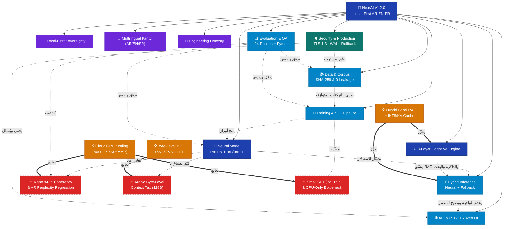
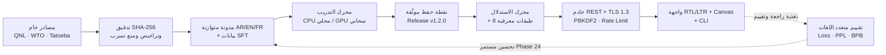

# 🕸️ تصور شبكة المعرفة بأسلوب TheBrain (`Parent · Child · Jump`)

في فلسفة **TheBrain**، لا تُحبس الفكرة داخل مجلد واحد؛ بل تقع كل فكرة (`Thought`) في مركز شبكة ديناميكية لها ثلاثة أنواع من الروابط:
- **⬆️ Parent (الأصل):** المفهوم الأعلى الذي تنبثق منه الفكرة.
- **⬇️ Child (الفروع):** المكونات التفصيلية التابعة لها.
- **↔️ Jump (الروابط الترابطية الجانبية):** علاقات تأثير، اعتماد، معالجة، أو تكامل مع أفكار من فروع أخرى تماماً.

---

## 1. الخريطة الشبكية الشاملة (Interactive Mermaid Knowledge Graph)

---

## 2. بطاقات الأفكار المحورية بأسلوب TheBrain (Thought Plex Cards)

### 🧠 Thought 1: `[[Pre-LN Decoder-Only Transformer]]`
- **⬆️ Parent:** `[[NourAI v1.2.0]]`
- **⬇️ Children:** `[[ByteTokenizer]]`, `[[Model Presets (Nano/Small/Base)]]`, `[[Weight Tying]]`, `[[Checkpoint Format]]`
- **↔️ Jumps:**
  - `← trained_by` `[[Training Engine]]`
  - `→ served_by` `[[Inference Engine]]`
  - `← audited_by` `[[Multilingual Evaluation]]`
  - `⚠️ constrained_by` `[[Gap: Arabic Byte-Level Context Tax]]`, `[[Gap: Nano Model Coherency]]`
  - `💡 upgraded_by` `[[Byte-Level BPE Multilingual Tokenizer]]`, `[[INT8/INT4 CPU Quantization & KV-Cache]]`

### ⚙️ Thought 2: `[[8-Layer Cognitive Architecture]]`
- **⬆️ Parent:** `[[NourAI v1.2.0]]`
- **⬇️ Children:** `[[FoundationModelEngine]]`, `[[ReasoningEngine]]`, `[[MemoryEngine]]`, `[[KnowledgeEngine]]`, `[[CodingEngine]]`, `[[EvaluationEngine]]`, `[[AgentEngine]]`, `[[NourAIPlatform]]`
- **↔️ Jumps:**
  - `→ uses_storage` `[[Local Memory & Document RAG]]`
  - `→ uses_tool` `[[Live Web Search]]`
  - `← protected_by` `[[Security Architecture]]` (AST Safe Math + SSRF Guard + Zip Bomb Limit)
  - `💡 evolved_by` `[[Graph-Aware Long-Term Memory]]`, `[[Hybrid Local RAG (BM25 + Tiny Embeddings)]]`

### 📚 Thought 3: `[[Data & Corpus Engineering]]`
- **⬆️ Parent:** `[[NourAI v1.2.0]]`
- **⬇️ Children:** `[[Corpus Acquisition & Adapters]]`, `[[Data Provenance & Leakage Audit]]`, `[[Balanced Corpus v1.2]]`, `[[SFT Dataset v1.2]]`
- **↔️ Jumps:**
  - `→ guarantees_goal` `[[Multilingual Parity AR-EN-FR]]`
  - `→ feeds` `[[Pretraining & Response-Masked SFT]]`
  - `⚠️ gap` `[[Gap: Small SFT Dataset Size]]`
  - `← verified_by` `[[Test Suite & Phase Audits]]`

### ⚡ Thought 4: `[[Inference & Hybrid Capabilities]]`
- **⬆️ Parent:** `[[NourAI v1.2.0]]`
- **⬇️ Children:** `[[Inference Engine]]`, `[[Fallback Assistant]]`, `[[Live Web Search]]`, `[[Local Memory & Document RAG]]`
- **↔️ Jumps:**
  - `→ enforces_goal` `[[Engineering Honesty & Telemetry]]`
  - `→ powers` `[[API Backend]]` & `[[Web UI & Canvas]]`
  - `⚠️ gap` `[[Gap: Arabic PDF Parsing]]`

### 🛡️ Thought 5: `[[Security, Production & DevOps]]`
- **⬆️ Parent:** `[[NourAI v1.2.0]]`
- **⬇️ Children:** `[[Security Architecture]]`, `[[Production Deployment]]`, `[[Release Lifecycle]]`
- **↔️ Jumps:**
  - `→ enforces_goal` `[[Local-First Sovereignty]]`, `[[Production Readiness & Reproducibility]]`
  - `→ wraps` `[[API Backend]]`, `[[Live Web Search]]`, `[[Local Memory & Document RAG]]`
  - `⚠️ gap` `[[Gap: Outdated API Reference Doc]]`

### 🤖 Thought 6 (v3.0.0): `[[Autonomous Agent Core v3.0]]`
- **⬆️ Parent:** `[[NourAI v3.0.0]]`
- **⬇️ Children:** `[[PerceptionEngine]]`, `[[ReasoningEngine]]`, `[[PlanningEngine]]`, `[[TaskManager]]`, `[[CriticEngine]]`, `[[RecoveryEngine]]`, `[[AutonomousAgentOrchestrator]]`
- **↔️ Jumps:**
  - `→ uses_memory` `[[Four-Tier Advanced Memory]]` & `[[Integrated Knowledge Graph]]`
  - `→ invokes` `[[Standardized Tool Engine]]` (9 sandboxed tools, least-privilege + approval gate)
  - `→ verified_by` `[[V3 Evaluation & Regression Gate]]`
  - `→ exposed_via` `[[V3APIRouter (/api/v3/*)]]`

### ⚡ Thought 7 (v3.1.0): `[[NourAI v3.1 Real-World Autonomy & Control Center]]`
- **⬆️ Parent:** `[[NourAI v3.1.0]]`
- **⬇️ Children:** `[[Neural Forensic Audit & v3.1 Checkpoint]]`, `[[DAG Parallel Tool Orchestrator]]`, `[[105-Task Real-World Agent Benchmark]]`, `[[Self-Evaluation Engine]]`, `[[NourAI Control Center Dashboard]]`
- **↔️ Jumps:**
  - `→ resolves` `[[Gap: Broken v1.2.0 Small Checkpoint Perplexity]]`
  - `→ upgrades` `[[Four-Tier Advanced Memory]]` (AR/FR normalization + preference superseding + stopword filtering)
  - `→ monitors` `[[Autonomous Agent Core v3.0]]` & `[[Standardized Tool Engine]]`

### 🔬 Thought 8 (v3.2.0): `[[NourAI v3.2 Research, Projects & Multimodal Intelligence]]`
- **⬆️ Parent:** `[[NourAI v3.2.0]]`
- **⬇️ Children:** `[[Autonomous Research Agent]]`, `[[Persistent Long-Term Project Manager]]`, `[[Advanced Reasoning Engine v3.2]]`, `[[Multimodal Document Intelligence]]`, `[[Control Center 2.0]]`, `[[205-Task Real-World Benchmark]]`
- **↔️ Jumps:**
  - `→ retrieves_citations_from` `[[Multimodal Document Intelligence]]`, `[[Four-Tier Advanced Memory]]`, `[[Integrated Knowledge Graph]]`
  - `→ persists_across_restarts` `[[SQLite WAL Persistence]]`
  - `→ monitored_by` `[[Self-Evaluation Engine]]` (9 KPIs, zero auto-unverified training)

---

## 3. خريطة تدفق القيمة والبيانات (End-to-End Dependency Flow)

