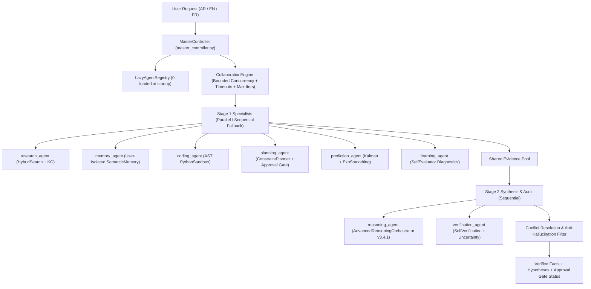

# JABRIX AI v3.5.0 — Multi-Agent Cognitive Architecture

**Branch:** `dev/v3.5` (branched from `dev/v3.4.1`)  
**Backward Compatibility:** 100% preserved across `v1.2.0` and `v3.0`–`v3.4.1` (`/api/v1/*`, `/api/v3/*`).  
**Hardware Target:** Intel Core i3 (4 logical CPUs), ~8 GB RAM, CPU-only.

---

## 1. System Overview

JABRIX AI v3.5.0 introduces a lightweight, modular Multi-Agent Cognitive Architecture under `nourai/multi_agent/` built directly on top of the shared v3.3/v3.4.1 knowledge and reasoning stack with **zero model or memory duplication**.

---

## 2. Specialized Agent Registry & Role Permissions

All 8 specialized agents implement `BaseSpecializedAgent` (`nourai/multi_agent/base.py`), accept `AgentTaskRequest`, return `AgentOutput`, and are registered lazily in `LazyAgentRegistry` (`loaded_count == 0` until first invoked):

| Agent Name | File | Underlying Engine | Allowed Permissions | Timeout |
| :--- | :--- | :--- | :--- | :--- |
| `research_agent` | `nourai/multi_agent/research_agent.py` | `HybridSearchEngine` + `KnowledgeGraph` | `knowledge:read` | 5.0 s |
| `reasoning_agent` | `nourai/multi_agent/reasoning_agent.py` | `AdvancedReasoningOrchestrator` (v3.4.1) | `knowledge:read` | 6.0 s |
| `coding_agent` | `nourai/multi_agent/coding_agent.py` | `PythonSandboxTool` (AST evaluator) | `compute:sandbox` | 3.0 s |
| `memory_agent` | `nourai/multi_agent/memory_agent.py` | `SemanticMemoryEngine` (user-isolated) | `knowledge:read` | 4.0 s |
| `planning_agent` | `nourai/multi_agent/planning_agent.py` | `ConstraintPlanningEngine` + Approval Gate | `plan:decompose`, `plan:evaluate` | 3.0 s |
| `verification_agent` | `nourai/multi_agent/verification_agent.py` | `SelfVerificationEngine` + `UncertaintyEngine` | `verify:claims`, `verify:uncertainty` | 4.0 s |
| `prediction_agent` | `nourai/multi_agent/prediction_agent.py` | `KalmanFilterAlgorithm` + `ExponentialSmoothingAlgorithm` | `predict:timeseries`, `hardware:read` | 3.0 s |
| `learning_agent` | `nourai/multi_agent/learning_agent.py` | `SelfEvaluator` (no unverified model updates) | `eval:read`, `eval:generate_tests` | 4.0 s |

---

## 3. Collaboration, Conflict Resolution & Safety Guarantees

1. **Lazy Initialization & Zero Duplication:** `V3APIRouter.get_multi_agent_controller()` shares the existing `HybridSearchEngine`, `SemanticMemoryEngine`, `KnowledgeGraph`, `AdvancedReasoningOrchestrator`, `SelfEvaluator`, `HardwareMonitor`, and `AdaptiveCache`.
2. **Resource-Aware Concurrency & Sequential Fallback:** `CollaborationEngine` caps `ThreadPoolExecutor` workers to `min(max_workers, cpu_count - 1)` (max 2–3 on Core i3) and automatically falls back to `workers=1` sequential execution when `HardwareMonitor.degraded_mode == True` or `force_sequential=True`.
3. **Infinite Loop Prevention & Timeouts:** `CollaborationEngine.MAX_HARD_ITERATIONS = 3` strictly bounds iteration count even if a caller passes `max_iterations=50`. Every agent invocation is guarded by `min(timeout_seconds, agent.spec.timeout_seconds)`.
4. **Evidence-Weighted Conflict Resolution:** When two agents emit contradictory claims on the same subject, `CollaborationEngine.resolve_conflicts()` scores each claim against `shared_evidence` using `SelfVerificationEngine`, selects the evidence-backed claim as winner, and demotes the losing claim to `hypotheses` (`status="REJECTED_IN_CONFLICT"`).
5. **Anti-Hallucination Enforcement:** Claims lacking evidence (`evidence_backed=False`), flagged by `verification_agent`, or rejected during conflict resolution are never placed in `verified_facts`; they are explicitly separated into `hypotheses`.
6. **Strict Per-User Memory Isolation:** `memory_agent` queries `SemanticMemoryEngine` scoped strictly to `request.user_id`.
7. **Human Approval Gate:** `planning_agent` detects consequential external/destructive actions (AR/EN/FR) and pauses execution in `status="AWAITING_APPROVAL"` until explicitly approved (`params.approved = true`).

---

## 4. REST API Endpoints (`nourai/api/v3_routes.py`)

| Method | Route | Auth | Description |
| :--- | :--- | :--- | :--- |
| `GET` | `/api/v3/multi-agent/registry` | Bearer | Returns registered agents, permissions, timeouts, and lazy-load status (`loaded_agents`). |
| `POST` | `/api/v3/multi-agent/execute` | Bearer | Executes a multilingual multi-agent task through `MasterController` with budgets (`max_agents`, `max_iterations`, `timeout_seconds`, `force_sequential`). |
