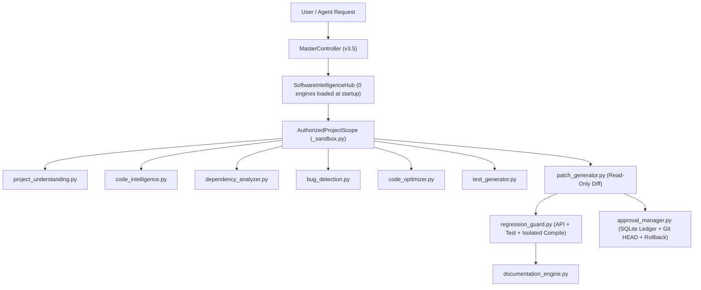

# JABRIX AI v3.6.0 — Autonomous Software Intelligence Architecture

**Branch:** `dev/v3.6` (branched from `dev/v3.5`)  
**Backward Compatibility:** 100% preserved across `v1.2.0` and `v3.0`–`v3.5.0` (`/api/v1/*`, `/api/v3/*`).  
**Hardware Target:** Intel Core i3 (4 logical CPUs), ~8 GB RAM, CPU-only.

---

## 1. System Overview

JABRIX AI v3.6.0 adds a project-aware, read-only-by-default **Autonomous Software Intelligence** subsystem (`nourai/software_intel/`) lazily shared across all 8 specialized agents and `MasterController` via `SoftwareIntelligenceHub`.

---

## 2. New Modules (`nourai/software_intel/`)

| Module | Class | Core Capabilities |
| :--- | :--- | :--- |
| `_sandbox.py` | `AuthorizedProjectScope` | Strict project-root confinement, traversal/symlink blocking (`ProjectIsolationError`), bounded file/byte caps. |
| `project_understanding.py` | `ProjectUnderstandingEngine` | Directory structure, file classification (`source`, `test`, `config`, `docs`, `script`), AST import map, layer discovery. |
| `code_intelligence.py` | `CodeIntelligenceEngine` | AST symbol/function/class indexing and cross-file reference graph (zero host execution). |
| `dependency_analyzer.py` | `DependencyAnalyzer` | `requirements.txt` / `requirements.lock` / `pyproject.toml` inventory, version conflict/unpinned checks, DFS circular dependency detection. |
| `bug_detection.py` | `BugDetectionEngine` | Static AST & pattern diagnostics (`SyntaxError`, `eval`/`exec`, `os.system`, `subprocess(shell=True)`, bare `except`, mutable defaults, hardcoded secrets, unreachable code). |
| `code_optimizer.py` | `CodeOptimizerEngine` | Cyclomatic complexity, nested loop (`O(n^k)`) bottleneck detection, loop string `+=` detection, oversized function warnings. |
| `test_generator.py` | `TestGeneratorEngine` | Pytest unit test scaffolding, bug-driven regression test generation, static public-symbol test coverage estimation. |
| `patch_generator.py` | `PatchGeneratorEngine` | Unified diff generation, AST syntax validation, SHA-256 hashing, strict preservation of original files. |
| `regression_guard.py` | `RegressionGuard` | Public API signature compatibility checks, existing test preservation, isolated temp-dir `python -I -m py_compile` check. |
| `documentation_engine.py` | `DocumentationEngine` | Architecture Markdown + Mermaid generator, dependency report, unified-diff change review report. |
| `approval_manager.py` | `ApprovalManager` | SQLite patch ledger (`v36_patch_ledger`), human approval gate, Git `HEAD` checkpoint capture, SHA-256 verified rollback. |
| `hub.py` | `SoftwareIntelligenceHub` | Lazy-loading facade sharing all 10 engines with `Coding`, `Research`, `Reasoning`, `Planning`, `Verification`, `Memory`, `Learning` agents and `MasterController`. |

---

## 3. Safety & Isolation Guarantees

1. **Zero Untrusted Host Execution:** Repository files are treated as untrusted input and parsed strictly via Python `ast.parse` and regex. Isolated validation runs `python -I -m py_compile` in a temporary directory without executing module code.
2. **Project Isolation:** All paths are resolved through `AuthorizedProjectScope.resolve_safe()`. Path traversal (`../`) and outside absolute paths raise `ProjectIsolationError` (HTTP `403`).
3. **Human Approval Gate:** `ApprovalManager.apply_approved_patch()` raises `PermissionError` for any patch not explicitly `APPROVED` by a reviewer.
4. **Deterministic Rollback & Audit Ledger:** Every proposed, approved, rejected, applied, and rolled-back patch is stored in SQLite (`v36_patch_ledger`) along with the Git `HEAD` commit hash, original content, and SHA-256 checksums.

---

## 4. REST API Endpoints (`nourai/api/v3_routes.py`)

| Method | Route | Auth | Description |
| :--- | :--- | :--- | :--- |
| `POST` | `/api/v3/software/analyze` | Bearer | Runs full static project analysis (structure, symbols, dependencies, bugs, optimization, coverage, docs). |
| `POST` | `/api/v3/software/patches/propose` | Bearer | Generates & validates unified diff + `RegressionGuard` report; records `PENDING_APPROVAL` without modifying original files. |
| `POST` | `/api/v3/software/patches/approve` | Bearer | Records human approval and optionally applies the verified patch (`apply: true`). |
| `POST` | `/api/v3/software/patches/rollback` | Bearer | Restores original file bytes and verifies original SHA-256. |
| `GET` | `/api/v3/software/patches` | Bearer | Lists recorded patch audit ledger. |
