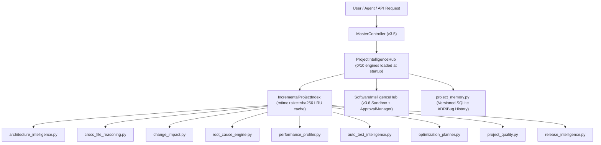

# JABRIX AI v3.7.0 — Deep Project Intelligence & Autonomous Optimization Architecture

**Branch:** `dev/v3.7` (branched from `dev/v3.6`)  
**Backward Compatibility:** 100% preserved across `v1.2.0` and `v3.0`–`v3.6.0` (`/api/v1/*`, `/api/v3/*`).  
**Hardware Target:** Intel Core i3 (4 logical CPUs), ~8 GB RAM, CPU-only.

---

## 1. System Overview

JABRIX AI v3.7.0 elevates JABRIX into a comprehensive project intelligence and autonomous optimization platform (`nourai/project_intel/`) built on a shared, bounded-memory **Incremental AST Indexer** (`IncrementalProjectIndex`) and lazily integrated with `SoftwareIntelligenceHub`, `ApprovalManager`, `MasterController`, and the 8 specialized agents.

---

## 2. New Engines (`nourai/project_intel/`)

| Module | Class | Core Capabilities |
| :--- | :--- | :--- |
| `_incremental_index.py` | `IncrementalProjectIndex` | Per-file `(mtime_ns, size, sha256)` incremental AST cache with bounded LRU (`max_cached_files=1000`); avoids full rescans when only a few files change. |
| `architecture_intelligence.py` | `ArchitectureIntelligenceEngine` | Global component dependency graph, architectural layer boundary violation detection, component-level circular architecture detection. |
| `cross_file_reasoning.py` | `CrossFileReasoningEngine` | Cross-file symbol relationships, multi-module function call graph, static AST data-flow analysis, REST API route dependency mapping. |
| `project_memory.py` | `ProjectMemoryEngine` | SQLite-backed project-scoped memory (`v37_project_memory`) for ADRs, bug/fix history, monotonic versioning, and automatic invalidation on file changes. |
| `change_impact.py` | `ChangeImpactEngine` | Git diff analysis, AST changed-symbol identification, BFS transitive downstream impact, regression risk scoring (`LOW`/`MEDIUM`/`HIGH`/`CRITICAL`). |
| `root_cause_engine.py` | `RootCauseEngine` | Traceback correlation, upstream dependency & recent-change analysis, static bug evidence fusion, ranked root-cause diagnostics. |
| `performance_profiler.py` | `PerformanceProfilerEngine` | Static CPU/memory bottleneck detection, optional isolated `tracemalloc`/`perf_counter` callable profiling, reproducible before/after comparison. |
| `auto_test_intelligence.py` | `AutoTestIntelligenceEngine` | Failure-driven regression test generation, AST edge-case identification, change-impact test prioritization, coverage gap detection. |
| `optimization_planner.py` | `OptimizationPlannerEngine` | Prioritized optimization recommendations with expected benefit, fan-in risk assessment, and Core i3 resource-aware execution steps. |
| `project_quality.py` | `ProjectQualityEngine` | Maintainability, cyclomatic complexity, test quality (ratio/assertions/coverage), and security posture scores (`0–100`). |
| `release_intelligence.py` | `ReleaseIntelligenceEngine` | Release readiness verdict (`READY`/`READY_WITH_WARNINGS`/`BLOCKED`), regression & dependency risk summary, Markdown release report. |
| `hub.py` | `ProjectIntelligenceHub` | Lazy facade (`0/10` loaded at init) sharing `IncrementalProjectIndex` and `SoftwareIntelligenceHub` across all agents and REST routes. |

---

## 3. REST API Endpoints (`nourai/api/v3_routes.py`)

| Method | Route | Auth | Description |
| :--- | :--- | :--- | :--- |
| `POST` | `/api/v3/project-intel/analyze` | Bearer | Runs deep project intelligence (architecture, cross-file, impact, optimization plan, quality, release readiness). |
| `POST` | `/api/v3/project-intel/impact` | Bearer | Computes changed symbols, downstream blast radius, impacted tests, and regression risk. |
| `POST` | `/api/v3/project-intel/root-cause` | Bearer | Ranks evidence-backed root causes from failure traces, dependencies, and static diagnostics. |
| `POST` | `/api/v3/project-intel/release-readiness` | Bearer | Evaluates release readiness and returns structured Markdown release report. |
| `GET` / `POST` | `/api/v3/project-intel/memory` | Bearer | Reads or records versioned project ADRs, bug/fix history, and optimization notes. |
