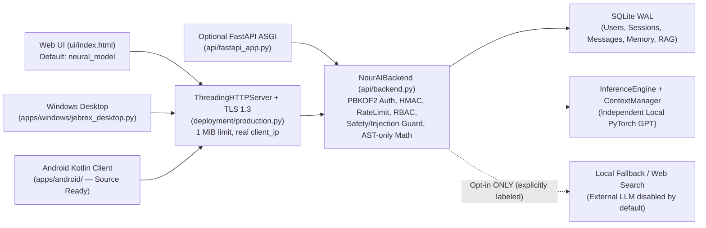

# Jebrex AI — البنية التقنية الحالية (`TECHNICAL_ARCHITECTURE.md`)

- **التاريخ:** `2026-11-24`
- **الإصدار الهندسي:** `Jebrex AI v1.3.0-audit` (مبني على مستودع `NourAI v1.2.0`)
- **النطاق:** توثيق تفصيلي للمعمارية الفعلية الموجودة والمُتحقَّق منها بالكود والاختبارات.

---

## 1. تدقيق مكونات نموذج المحول (`model/transformer.py` — 12 محوراً)

| المكون المعماري | التنفيذ الفعلي في الكود | التقييم الهندسي |
|---|---|---|
| **1. Embeddings** | `nn.Embedding(vocab_size=260, d_model)` مرتبطة الأوزان مع `head` (`self.head.weight = self.token.weight`) | سليم وموفر للذاكرة، لكن المفردات بايتية (`260`) وليست `Subword BPE` |
| **2. Positional Encoding** | تضمين موضعي مطلق متعلم `nn.Embedding(context_length, d_model)` (`0 .. context_length - 1`) | يعمل بدقة؛ لا يدعم الاستقراء لما بعد `context_length` (يلزم `RoPE` في المستوى 2+) |
| **3. Attention** | `nn.MultiheadAttention(..., batch_first=True)` مع قناع سببي مثلثي علوي (`causal_mask`, `diagonal=1`) | سليم رياضياً (صفر تسرب مستقبلي مثبت بالاختبار)؛ يفتقر لـ `KV-Cache` حالياً |
| **4. Multi-Head Attention** | `4` رؤوس في `Nano` (`head_dim=32`)، `8` رؤوس في `Small` (`head_dim=32`) و`Base` (`head_dim=64`) | مناسب للأحجام الصغيرة؛ يُستبدل بـ `GQA` و`FlashAttention` عند التوسع |
| **5. Feed Forward Networks** | `Linear(d_model, 4*d_model) -> GELU -> Linear(4*d_model, d_model) -> Dropout` | معمارية GPT-2 القياسية؛ تعمل بثبات على CPU (`SwiGLU` خيار لاحق) |
| **6. Normalization** | `Pre-LayerNorm` (`ln1` قبل الانتباه، `ln2` قبل FFN، `norm` نهائي) | ممتاز للاستقرار العددي أثناء التدريب (`RMSNorm` خيار لاحق) |
| **7. Residual Connections** | وصلات تخطّي `x = x + attended` و`x + ff(ln2(x))` | سليمة مع تحجيم تهيئة GPT-2 العمقي |
| **8. Context Length** | `128` (`Nano`)، `256` (`Small`)، `512` (`Base`) بوحدة **البايت** | **قيد حرج للعربية:** الحرف العربي يستهلك `~1.80` بايت، أي أن `256` بايت ≈ `140` حرفاً عربياً فقط! |
| **9. Vocabulary / Tokenizer** | `ByteTokenizer` (`tokenizer/byte_tokenizer.py`): `0..255` UTF-8 بايتات + `256:PAD, 257:BOS, 258:EOS, 259:UNK` | `100%` غير فاقد؛ صفر OOV؛ لكنه يطيل التسلسل `~3x–5x` مقارنة بـ BPE `64K–128K` |
| **10. Parameter Count** | معادلة دقيقة: $V d + C d + L(12 d^2 + 13 d) + 2 d$ ⇒ `Nano: 843,008`، `Small: 4,871,168`، `Base: 25,615,360` | مناسب لعتاد CPU الحالي في `Nano`/`Small`؛ `Base` بطيء جداً للتدريب على `i3-10110Y` |
| **11. Initialization** | `normal(0, 0.02)` + تحجيم إسقاطات البواقي `0.02 / sqrt(2 * n_layers)`، و`LayerNorm` بـ `1/0` | مطابق لأفضل ممارسات GPT-2 |
| **12. Loss Function** | `F.cross_entropy` مع دعم `ignore_index` المضاف في المرحلة 4 (`model/transformer.py`) | يدعم الآن إخفاء التوكنات (`PAD`/`-100`) أصلياً في SFT دون كسر التوافق |

---

## 2. منظومة التدريب والاستئناف (`training/`)

- **`training/trainer.py`:** حلقة تدريب `CPU-first FP32` مع تجميع التدرجات، قص التدرجات (`clip_grad_norm_` مع `error_if_nonfinite=True`)، جدولة `linear_warmup_cosine`، تتبع الذاكرة والخطوات في `JSONL`، إيقاف مبكر (`EarlyStopping`)، وحفظ ذري عبر `CheckpointManager` (`os.fsync` + `os.replace` + أرشيف `history/`).
- **الاستئناف والتعافي (`resume_with_recovery` + `optimizer_scheduler_state_summary`):** يستعيد أوزان النموذج + عزوم `AdamW` (`exp_avg`, `exp_avg_sq`, `step`) + حالة `Scheduler` (`last_epoch`, `lr`) + حالة `RNG` لـ PyTorch وPython، مع تعافٍ تلقائي إلى أحدث نسخة احتياطية عند تلف `last.pt`.
- **حراسة البوابات (`training/jebrex_train.py`):** يرفض بدء التدريب إذا فشلت بوابة البيانات (`DATA_READY`) أو في حال طلب CUDA غير معتمد أو انخفاض المساحة الحرة عن `256 MiB`.

---

## 3. محرك الاستدلال والمحادثة (`inference/engine.py`)

- **استراتيجيات التوليد:** `greedy`, `temperature`, `top_k`, `top_p`, و**`top_k_top_p`** (المدمج الجديد)، مع `repetition_penalty` وحارس ضد قيم `NaN/Inf`.
- **البث التدريجي الآمن (`stream_generate`):** فك ترميز UTF-8 متدرج + **عازل حجز لسلاسل التوقف (`stop_sequences holdback buffer`)** يمنع تسرب وسوم `<|user|>` و`<|endoftext|>` عبر الحدود الجزئية، مع دعم الإلغاء الخارجي (`cancel_event`).
- **إدارة السياق متعدد الأدوار (`ConversationContextManager`):** يبني السياق `<|user|>\n...\n<|assistant|>\n` داخل ميزانية `context_length` مع الحفاظ على آخر رسالة مستخدم وتقليم الأدوار الأقدم نظيفاً.

---

## 4. الخادم والواجهات والتطبيقات (`api/`, `deployment/`, `ui/`, `apps/`)

- **الخادم النشط:** `deployment/production.py` (`ThreadingHTTPServer` + `TLSv1.3` + `SQLite WAL` مع النسخ الاحتياطي والاستعادة)؛ يتوفر أيضاً محول `api/fastapi_app.py` للعمل مع `FastAPI/uvicorn` فور تثبيتهما.
- **مخطط التطوير التدريجي للنموذج (خطة المرحلة 4):**
  1. **المرحلة 1 (منجزة محلياً):** نموذج `Nano 843K` للتحقق من سلامة مسار التدريب النظيف والاستئناف (`jebrex_v1_sanity`).
  2. **المرحلة 2:** استبدال `ByteTokenizer` بمُرمِّز `Subword BPE (64K)` وتوسيع السياق إلى `2048–4096` على بيانات نظيفة مرخصة (`>= 500M–2B` توكن).
  3. **المرحلة 3:** تحسين الاستدلال بإضافة `KV-Cache` وتكميم `INT8/INT4` (عبر `GGUF`/`llama.cpp` أو `torch.ao`) لرفع سرعة CPU.
  4. **المرحلة 4:** تدريب نموذج `350M–1.5B` مع `RoPE + RMSNorm + SwiGLU + GQA` على عتاد GPU سحابي/مؤسسي.
  5. **المرحلة 5:** ضبط تعليمات `SFT` حقيقي غير قالبي ومواءمة تفضيلات (`DPO/ORPO`) للمحادثة متعددة الأدوار.
  6. **المرحلة 6:** تقييم مستقل شامل لقدرات الاستدلال والبرمجة والرياضيات والسلامة والأدوات.
