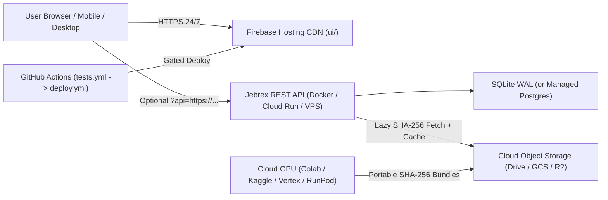

# 2. Cloud Infrastructure Report (`CLOUD_INFRASTRUCTURE_REPORT.md`)

- **Audit Date (UTC):** `2026-11-24`
- **Design Principle:** Cloud-First, Storage-Efficient, Strict Layer Separation, Honest Free-Tier Boundaries

## 1. Local & Cloud Tooling Inventory (Verified)

| Tool / Service | Availability | Verified Account / Target | Role |
|---|---|---|---|
| **Git & GitHub** | Installed (`git.exe`), authenticated | `https://github.com/ypy999/NourAI.git` | Source control, releases, CI/CD via GitHub Actions |
| **Firebase CLI** | Installed (`firebase.cmd`), authenticated | `adboadbo1224@gmail.com` -> project `ypyai-95ca7` | 24/7 Static Frontend Global CDN + TLS |
| **Render (`render.yaml`)** | Configured in repo; **NOT deployed** | `https://nourai-studio.onrender.com/api/v1/health` returned **HTTP 404** (372ms) | Optional free backend — **NOT 24/7** (sleeps after 15 min idle) |
| **Docker / `gcloud` / `gh` / `wrangler`** | Not installed on local Windows host | N/A | `Dockerfile` & `docker-compose.yml` ready for cloud/CI hosts |
| **Local Host Hardware** | Windows 10 Pro, Intel Core i3-10110Y (`2C/4T`, 1.51 GHz), `7.89 GiB` RAM, **No CUDA GPU** | `C:` `6.71 GiB` free; `D:` `14.7 GiB` free | Local development, CPU verification, never used for 125M–350M pretraining |

## 2. Separated Production Architecture

## 3. Honest 24/7 Hosting Assessment

1. **Frontend (True 24/7 at \$0/month):** Hosted on Firebase Hosting Global CDN (`https://ypyai-95ca7--jebrex-prod-vpozlkst.web.app`). Serves `/`, `/about.html`, `/privacy.html`, `/report-bug.html`, `/manifest.json`, `/robots.txt`, `/icon.svg` over HTTPS/HSTS with zero sleep delays.
2. **Backend API (Requires Always-On Compute for True 24/7):**
   - `render.yaml` Free tier spins down after **15 minutes of inactivity** (~50s cold start) and is **explicitly NOT 24/7**.
   - Recommended true 24/7 options documented in [`docs/DEPLOYMENT.md`](../../docs/DEPLOYMENT.md): Oracle Cloud Always-Free ARM VM (`Docker Compose`), Google Cloud Run (`min-instances=1`, paid), Fly.io Always-On, or a dedicated self-hosted server.
3. **Training Compute:** Offloaded cleanly to Cloud GPUs (Colab T4/L4/A100, Kaggle 2×T4, RunPod/Vertex) via `notebooks/JebrexAI_Cloud_GPU_Training.ipynb` with Google Drive/GCS checkpoint resume.
